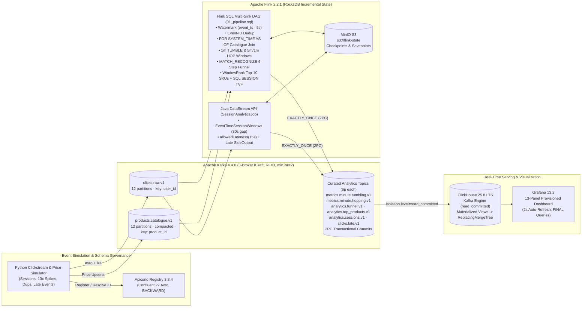
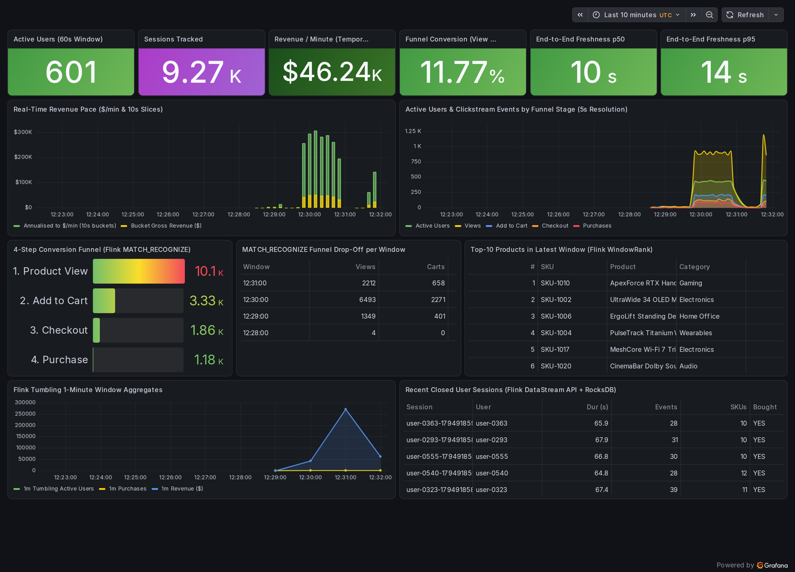

# Real-Time E-Commerce Clickstream Analytics on Apache Kafka 4.4 & Apache Flink 2.2

[](https://github.com/Manzoor25/kafka-flink-clickstream/actions/workflows/ci.yml)
[](LICENSE)

A complete, runnable real-time e-commerce analytics platform built on **Apache Kafka 4.4.0 (3-broker KRaft)**, **Apache Flink 2.2.1** (Flink SQL + Java DataStream API with RocksDB incremental S3 checkpoints), **Apicurio Schema Registry 3.3.4**, **ClickHouse 25.8 LTS**, and a **provisioned Grafana 13.2 dashboard**.

---

## The Problem

An e-commerce storefront needs a live operational dashboard that is **never more than a few seconds stale**—tracking active users, shopper sessions, 4-step funnel conversion (`view -> add_to_cart -> checkout -> purchase`) with per-step drop-off, Top-N revenue-generating SKUs, and revenue per minute.

Delivering those metrics accurately in real time requires solving five classic distributed-systems failure modes simultaneously:
1. **At-least-once retries & duplicates:** Mobile SDKs and edge gateways retry timed-out requests (`3–5%` duplicate `event_id`s) that would inflate revenue if counted naively.
2. **Out-of-order & offline-tab mobile events:** Cellular handoffs reorder clicks by `0.5–4 s`, while backgrounded browser tabs flush clicks `45–75 s` late.
3. **Mid-minute promotional price changes:** Joining clicks against a mutable `products` table retroactively corrupts historical revenue when a flash sale changes a SKU's price; every click must pick up the exact catalogue price valid *at the millisecond the click occurred*.
4. **Worker crashes & 2PC uncommitted data:** When a Flink TaskManager dies mid-checkpoint, downstream consumers without `isolation.level=read_committed` read uncommitted dirty aggregates that double-count once recovery replays the checkpoint.
5. **Lambda dual-codebase drift:** Maintaining separate streaming and nightly batch codebases inevitably produces conflicting executive totals when Kafka can instead serve as the replayable source of truth (Kappa architecture).

---

## Architecture



---

## Live Provisioned Grafana Dashboard



*13-panel Grafana dashboard provisioned entirely from [`docker/grafana/`](docker/grafana/) showing active shoppers, sessions, revenue/min (`1m` tumbling + `5m/1m` hopping), 4-step `MATCH_RECOGNIZE` funnel conversion & step drop-offs, Top-10 SKUs with point-in-time joined catalogue prices, device breakdown, and audited late events.*

---

## Measured Results Summary

| Verification / Benchmark | Measured Result | Artifact |
|---|---|---|
| **Kafka 4.4 `lz4` Batching (`linger.ms=20, 64 KiB`)** | **`318,790 events/s`** · **`3.12x`** compression (`0.320` wire/raw) · `15.15 ms` ACK `p50` | [`benchmarks/results/producer_benchmark.md`](benchmarks/results/producer_benchmark.md) |
| **Kafka 4.4 `zstd` Batching (`linger.ms=50, 128 KiB`)** | **`229,236 events/s`** · **`5.29x`** compression (`0.189` wire/raw) · `28.41 ms` ACK `p50` | [`benchmarks/results/producer_benchmark.json`](benchmarks/results/producer_benchmark.json) |
| **Streaming vs Batch Recount (`make demo`)** | **`17,755 / 17,755`** unique events · **`$314,270.45 / $314,270.45`** revenue (**`$0.00` drift**) | [`benchmarks/results/demo_recount.json`](benchmarks/results/demo_recount.json) |
| **2PC `read_committed` Isolation Proof** | `read_uncommitted` saw **`1`** dirty uncommitted record; `read_committed` saw **`0`** (`196` 2PC markers) | [`benchmarks/results/isolation_level.json`](benchmarks/results/isolation_level.json) |
| **Creation $\rightarrow$ Grafana `/api/ds/query` Freshness** | **`p50 = 10.73 s`**, **`p95 = 13.71 s`** (`5.73 s` `p50` post-watermark overhead; `10 s` live panel `p50`) | [`benchmarks/results/freshness_report.json`](benchmarks/results/freshness_report.json) |
| **Chaos 1 — Kill Active TaskManager (`SIGKILL`)** | Restored RocksDB S3 checkpoint in **`18.98 s`** · **`7,912 / 7,912`** events · **`$0.00` drift** | [`benchmarks/results/demo_kill_taskmanager.json`](benchmarks/results/demo_kill_taskmanager.json) |
| **Chaos 2 — $10\times$ Traffic Spike (`450 -> 4,500 ev/s`)** | Peak lag **`51,929`** · backpressure **`0.482`** · busy **`0.793`** $\rightarrow$ recovered to **`0` lag** | [`benchmarks/results/demo_traffic_spike.json`](benchmarks/results/demo_traffic_spike.json) |
| **Chaos 3 — S3 Savepoint Query Upgrade (`v1 -> v2`)** | Preserved **`2,278`** `v1` sessions + emitted **`467`** `v2` sessions (**`261`** intent-classified) | [`benchmarks/results/demo_savepoint_upgrade.json`](benchmarks/results/demo_savepoint_upgrade.json) |
| **Chaos 4 — Kappa Replay from `earliest-offset`** | Rebuilt all 6 wiped ClickHouse tables (`72,037` unique non-late events, `$1,253,294.80`, **`$0.00` drift**) | [`benchmarks/results/demo_reprocess_recount.json`](benchmarks/results/demo_reprocess_recount.json) |

---

## Pinned Stack & Architecture Decisions

| Layer | Component | Pinned Version | Architectural Rationale |
|---|---|---|---|
| **Event Log** | Apache Kafka (KRaft) | `apache/kafka:4.4.0` (3 brokers) | ZooKeeper-free Raft quorum, `RF=3`, `min.insync.replicas=2`, 12 ingress partitions ([ADR-0001](docs/adr/0001-kafka-4-kraft-three-broker-topology.md), [ADR-0005](docs/adr/0005-topic-partitioning-key-and-compression.md)) |
| **Stream Compute** | Apache Flink | `flink:2.2.1-scala_2.12-java17` (1 JM + 2 TMs) | SQL TVFs + `MATCH_RECOGNIZE` + temporal joins alongside Java DataStream sessioniser ([ADR-0002](docs/adr/0002-flink-2-2-rocksdb-checkpoints-on-minio.md)) |
| **State & Checkpoints** | RocksDB + MinIO S3 | `alpine/minio:RELEASE.2025-10-15T17-29-55Z` | Incremental SST checkpoints every `2 s` and versioned S3 savepoints ([ADR-0002](docs/adr/0002-flink-2-2-rocksdb-checkpoints-on-minio.md)) |
| **Schema Registry** | Apicurio Registry | `apicurio/apicurio-registry:3.3.4` | Apache-2.0 Confluent v7 API compatibility with `BACKWARD` Avro evolution ([ADR-0004](docs/adr/0004-apicurio-registry-avro-wire-contracts.md)) |
| **Serving Store** | ClickHouse | `clickhouse/clickhouse-server:25.8.33.6-alpine` | Native `read_committed` Kafka consumers + idempotent `ReplacingMergeTree` upserts in ~350 MB RAM ([ADR-0003](docs/adr/0003-clickhouse-over-pinot-serving-store.md), [ADR-0007](docs/adr/0007-end-to-end-delivery-guarantees-and-isolation.md)) |
| **Dashboard** | Grafana | `grafana/grafana:13.2.6` + ClickHouse `4.23.5` | GitOps YAML/JSON provisioning with sub-second SQL rendering ([ADR-0006](docs/adr/0006-grafana-over-superset-provisioned-dashboard.md)) |

---

## One-Command Quickstart

### Prerequisites
- Docker Engine `24+` with Docker Compose `v2` (`>= 8 GB` RAM allocated)
- Python `3.11+` (`pip install -r requirements.txt`) and GNU `make`
- *(Optional)* JDK 17 + Maven `3.9+` (`make test` automatically falls back to a Maven Docker container if `mvn` is not installed locally)

### Run the Platform

```bash
# Install host Python CLI dependencies (generator, recount verifier, freshness & ops probes)
pip install -r requirements.txt

# 1. Build images, boot the 9-container cluster, create 10 KRaft topics, register Avro schemas,
#    initialize ClickHouse Kafka pipelines, seed the product catalogue & deploy both Flink 2.2 jobs
make up

# 2. Stream realistic e-commerce sessions (with duplicates, jitter, late events & live price updates),
#    audit 2PC read_committed isolation, assert exact batch recount parity & measure p50/p95 freshness
make demo

# 3. Run Python unit/contract tests, Flink 2.2 MiniCluster fixed-file tests, and live smoke checks
make test

# 4. Stop all containers and remove volumes cleanly
make down
```

### Local Service Endpoints
| Service | URL | Credentials |
|---|---|---|
| **Grafana Live Dashboard** | `http://localhost:3000/d/clickstream-rt/real-time-e-commerce-clickstream-analytics` | Anonymous Viewer enabled (`admin` / `admin_local` for edit) |
| **Flink 2.2 Web UI** | `http://localhost:8081` | None |
| **Apicurio Schema Registry** | `http://localhost:8085/apis/ccompat/v7/subjects` | None |
| **ClickHouse HTTP SQL** | `http://localhost:8123` | `clickstream` / `clickstream_local` |
| **MinIO S3 Console** | `http://localhost:9011` | `localminio` / `localminio123` |

---

## Feature-to-Code Map

| # | Engineering Capability | Implementation |
|---|---|---|
| 1 | **High-volume topic math & `lz4`/`zstd` + batching benchmark** | [`docs/design.md`](docs/design.md#2-throughput-partition-sizing--producer-compression-maths), [`benchmarks/benchmark_producer.py`](benchmarks/benchmark_producer.py) |
| 2 | **Flink SQL Kafka sources with watermarks & explicit lateness policy** | [`flink-sql/01_pipeline.sql`](flink-sql/01_pipeline.sql) (`WATERMARK FOR event_ts AS event_ts - INTERVAL '5' SECOND`, `table.exec.source.idle-timeout = '30 s'`) |
| 3 | **Stateful event deduplication by `event_id`** | [`flink-sql/01_pipeline.sql`](flink-sql/01_pipeline.sql) (`ROW_NUMBER() OVER (PARTITION BY event_id ORDER BY event_ts ASC)`) & [`SessionAnalyticsJob.java`](flink-jobs/src/main/java/io/clickstream/flink/SessionAnalyticsJob.java) (`EventDeduplicator` w/ `StateTtlConfig`) |
| 4 | **Tumbling (`1m`) and hopping (`5m` size, `1m` slide) window aggregates** | [`flink-sql/01_pipeline.sql`](flink-sql/01_pipeline.sql) (`TUMBLE` -> `metrics.minute.tumbling.v1`, `HOP` -> `metrics.minute.hopping.v1`) |
| 5 | **Sessionisation (`30s` inactivity gap + `15s` allowed lateness + side-output)** | [`SessionAnalyticsJob.java`](flink-jobs/src/main/java/io/clickstream/flink/SessionAnalyticsJob.java) (`EventTimeSessionWindows`) & [`flink-sql/01_pipeline.sql`](flink-sql/01_pipeline.sql) (`SESSION` TVF) |
| 6 | **4-step funnel (`view -> add_to_cart -> checkout -> purchase`) & drop-off** | [`flink-sql/01_pipeline.sql`](flink-sql/01_pipeline.sql) (`MATCH_RECOGNIZE` within `10m` session bound -> `analytics.funnel.v1`) |
| 7 | **Windowed Top-N (`Top 10`) products by revenue & views** | [`flink-sql/01_pipeline.sql`](flink-sql/01_pipeline.sql) (`WindowRank` over `1m` tumbling SKU totals -> `analytics.top_products.v1`) |
| 8 | **Point-in-time temporal join against compacted `upsert-kafka` catalogue** | [`flink-sql/01_pipeline.sql`](flink-sql/01_pipeline.sql) (`LEFT JOIN products_catalogue FOR SYSTEM_TIME AS OF c.event_ts`) |
| 9 | **2PC `exactly-once` Kafka sinks & `read_committed` isolation proof** | [`flink-sql/01_pipeline.sql`](flink-sql/01_pipeline.sql), [`docker/clickhouse/config.d/kafka.xml`](docker/clickhouse/config.d/kafka.xml), [`scripts/verify_isolation_level.py`](scripts/verify_isolation_level.py) |
| 10 | **Real-time ClickHouse ingestion & provisioned Grafana dashboard as code** | [`docker/clickhouse/`](docker/clickhouse/), [`docker/grafana/dashboards/clickstream-realtime.json`](docker/grafana/dashboards/clickstream-realtime.json) |
| 11 | **End-to-end creation-to-Grafana freshness (`p50` & `p95`)** | [`scripts/measure_freshness.py`](scripts/measure_freshness.py) |
| 12 | **Savepoints, zero-state-loss upgrades, lag & backpressure monitoring** | [`scripts/monitor_ops.py`](scripts/monitor_ops.py), [`scripts/demos/demo_savepoint_upgrade.sh`](scripts/demos/demo_savepoint_upgrade.sh) |

---

## Failure & Recovery Demos

Run each failure scenario against a live stack (`make up`):

### 1. Kill a TaskManager Under Load (`make demo-kill-tm`)
Abruptly `SIGKILL`s the active Flink TaskManager container (`docker kill`) mid-stream while the Python generator is actively publishing duplicate-injected clicks and catalogue price mutations, waits for Flink to restore RocksDB incremental state onto the standby TaskManager from MinIO S3 and fence uncommitted 2PC Kafka transactions, and verifies **zero drift** against a deterministic raw-ledger batch recount.

```bash
make demo-kill-tm
```

**Measured Output:**
```json
{
  "batch_recount": { "unique_events": 7912, "active_users": 599, "purchases": 458, "gross_revenue": 120436.95 },
  "streaming_clickhouse": { "unique_events": 7912, "active_users": 599, "purchases": 458, "gross_revenue": 120436.95 },
  "diff": { "unique_events": 0, "active_users": 0, "purchases": 0, "gross_revenue": 0.0 },
  "passed": true,
  "failover": { "restored_checkpoints": 1, "completed_checkpoints": 69, "recovery_sec": 18.98 }
}
```

---

### 2. Push a 10x Traffic Spike (`make demo-spike`)
Drives a baseline stream (`450 events/s`), injects a sudden **`10x` burst (`4,500 events/s`)**, records Flink vertex throughput/backpressure ratios and Kafka consumer-group lag (`scripts/monitor_ops.py`) throughout the surge, and verifies clean lag drainage back to `0` with zero failed checkpoints.

```bash
make demo-spike
```

**Measured Output:**
```json
{
  "baseline_rate_eps": 450,
  "spike_rate_eps": 4500,
  "spike_multiplier": 10.0,
  "peak_total_lag": 51929,
  "peak_flink_backpressure_ratio": 0.482,
  "peak_flink_busy_ratio": 0.793,
  "post_recovery_flink_source_lag": 0,
  "recovered_to_zero_lag": true
}
```

---

### 3. Stateful Query Upgrade from an S3 Savepoint (`make demo-savepoint`)
Starts shopper journeys (leaving open sessions inside RocksDB window state), triggers an atomic stop-with-savepoint to `s3://flink-state/savepoints`, deploys an upgraded query (`--job-version v2`, activating buyer/cart-abandoner intent classification via stable operator UIDs `kafka-clicks-raw-source`, `deduplicate-by-event-id`, `user-session-window-agg`), and closes open sessions after the 30-second inactivity gap with zero state loss.

```bash
make demo-savepoint
```

**Measured Output:**
```json
{
  "savepoint_uri": "s3://flink-state/savepoints/savepoint-991c20-d81561cdc375",
  "is_savepoint": true,
  "v1_sessions_in_clickhouse": 2278,
  "v2_sessions_in_clickhouse": 467,
  "v2_intent_enriched_sessions": 261,
  "passed": true
}
```

---

### 4. Full Kappa Replay from `earliest-offset` (`make demo-reprocess`)
Truncates all 6 ClickHouse serving tables to `0` rows and redeploys the **exact same Flink SQL & DataStream codebase** configured with `earliest-offset` against the retained Kafka log, deterministically rebuilding every revenue, session, funnel, and Top-N metric to match the batch recount (`drift = $0.00`).

> **Why this replaces a separate Lambda batch layer:** Because Kafka retains the immutable raw clickstream (`clicks.raw.v1`) alongside the full compacted history of price revisions (`products.catalogue.v1`), and Flink processes purely in **event time** (`FOR SYSTEM_TIME AS OF c.event_ts`) into idempotent `ReplacingMergeTree` primary keys, re-running the streaming DAG from offset `0` produces bit-identical results—eliminating dual stream/batch codebases and reconciliation drift.

```bash
make demo-reprocess
```

**Measured Output:**
```json
{
  "after_truncate": {
    "clicks_enriched": 0, "minute_metrics_tumbling": 0, "minute_metrics_hopping": 0,
    "user_sessions_sql": 0, "funnel_window_metrics": 0, "top_products_window": 0
  },
  "rebuilt_from_earliest_offset": {
    "clicks_enriched": 72359, "minute_metrics_tumbling": 8, "minute_metrics_hopping": 10,
    "user_sessions_sql": 2914, "funnel_window_metrics": 5, "top_products_window": 78
  },
  "raw_kafka_recount": {
    "unique_events": 72037, "active_users": 625, "purchases": 4377, "gross_revenue": 1253294.8,
    "diff_revenue": 0.0, "passed": true
  }
}
```

---

## Testing & Continuous Integration

- **Python Unit & Contract Suite (`pytest`):** Validates deterministic Zipf/Markov clickstream generation, duplicate/late injection ratios, batch recount maths, ClickHouse `FINAL` dashboard SQL contracts, and infrastructure invariants (`tests/test_generator_and_recount.py`, `tests/test_sql_and_repo_contracts.py`).
- **Flink 2.2 `MiniCluster` Fixed-File Suite (`mvn test`):** Executes the production SQL logic (`01_pipeline.sql`) and Java `SessionAnalyticsJob` against deterministic JSONL fixture inputs (`flink-jobs/src/test/resources/fixtures/`) with exact expected assertions across deduplication, `$200 -> $150` temporal price joins, `TUMBLE`/`HOP`/`SESSION` windows, `MATCH_RECOGNIZE` funnel drop-offs, Top-N ranking, `+15s` allowed lateness merges, and `>20s` late side-outputs.
- **Live End-to-End CI Smoke & Chaos Workflow ([`.github/workflows/ci.yml`](.github/workflows/ci.yml)):** Runs on every push—executing Ruff, Pytest, Maven `MiniCluster` tests, booting all 9 containers (`make up`), running `make demo`, `tests/test_live_smoke.py`, codec benchmarks, and all 4 failure demos.

---

## Documentation Index

- **[System Design Document (`docs/design.md`)](docs/design.md):** Requirements, 12-partition throughput math, measured `lz4`/`zstd` & batching benchmarks, event-time/lateness policy, RocksDB state estimates, guarantees per hop, ClickHouse vs Pinot trade-offs, and production evolution.
- **[Architecture Decision Records (`docs/adr/`)](docs/adr/):** 7 concise ADRs (`0001` through `0007`) covering every major stack and semantics choice.
- **[Customer & Staff Interview Q&A (`docs/interview-questions.md`)](docs/interview-questions.md):** 10 tough architectural questions and detailed answers.
- **[LinkedIn Engineering Article (`docs/linkedin-article.md`)](docs/linkedin-article.md) & [Teaser Post (`docs/linkedin-post.md`)](docs/linkedin-post.md):** First-person build write-up grounded exclusively in measured numbers from this repository.

